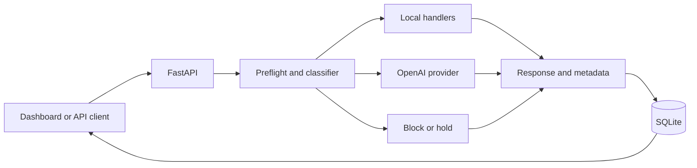

# Reflex

A System-1 / System-2 AI gateway that aims to reduce unnecessary GPT calls by
handling supported simple requests locally.

The API provides validated requests, deterministic routing, five local capabilities, preflight guardrails, and
an asynchronous OpenAI provider. The bootstrap classifier uses explicit command
and keyword rules, not a trained model. **Laya integration is pending identification
of its library/service.** Local-only mode is the default and needs no credentials;
unknown prompts return HTTP 503 until OpenAI is enabled.

## Run locally

Install Python 3.12+ and uv, then from this directory:

```bash
uv sync
uv run uvicorn app.main:app --reload --host 127.0.0.1
```

Open http://127.0.0.1:8000/ for the dashboard or `/docs` for the interactive API. `GET /health` is a liveness
check; it does not assert that external providers are configured.

```bash
curl http://127.0.0.1:8000/query \
  -H 'Content-Type: application/json' \
  -d '{"prompt":"What is Reflex?"}'
```

The response includes `answer`, `route`, `prediction`, `llm_used`, `request_id`,
and `latency_ms`. FAQs include `What is Reflex?`, `What can you do?`, and `Do you store my prompts?`
(case-insensitive, with surrounding whitespace ignored). Requests accept only a
`prompt` string of 1–8,000 characters after trimming; invalid input returns 422.

Risk 4–5 blocks and risk 3 returns a held review response. No review queue exists
yet. Other requests use System 2 if the classifier requires it, complexity exceeds
2, confidence is below 0.85, or no local handler exists. Local preflight checks run
before the classifier: matching harmful-instruction phrases block, and likely
pasted secrets are held for review. These are narrow rules, not comprehensive
moderation. Non-matching inputs still receive placeholder risk 0 from the bootstrap
classifier. See [routing behavior and limitations](docs/local-routing.md).

## Dashboard and Docker

The dashboard shows request totals, local routes, provider attempts, failures,
mean/P95 latency, known estimated cost, and recent metadata. Submit a local command
from the same page; unknown prompts can incur charges when GPT is configured.

```bash
docker compose up --build -d
```

Compose binds to localhost and preserves SQLite in a named volume. See the
[release runbook](docs/release.md) for configuration, CI, backups, and remaining
release checks.



## Try the local handlers

Send any of these prompts to `POST /query` without an API key:

| Prompt | Result |
| --- | --- |
| `calc: (2 + 3) * 4` | `20` |
| `0.1 + 0.2` | `0.3` |
| `support: I need a refund` | Suggests billing; does not send a ticket |
| `lookup: service.api` | Returns the public local catalog entry |
| `classify: This is great` | Returns a keyword-based positive label |

Ambiguous support/sentiment requests escalate. Invalid arithmetic commands return
an explanatory local answer. See [local routing](docs/local-routing.md) for bounds,
supported commands, and guardrail limitations. The lookup catalog is in memory;
SQLite stores request metadata separately from that catalog.

## Enable GPT

```bash
cp .env.example .env
```

Edit `.env` locally: set `SYSTEM2_PROVIDER=openai`, `OPENAI_API_KEY`, and
`OPENAI_MODEL` to a Responses-compatible model available in your OpenAI project.
Restart the server. Environment variables override `.env`. Credentials and local
project planning files are ignored by Git. Do not paste credentials into chat.

| Setting | Default | Meaning |
| --- | --- | --- |
| `SYSTEM2_PROVIDER` | `disabled` | `disabled` for local FAQs, `openai` for GPT escalation |
| `OPENAI_API_KEY` | empty | Required when OpenAI is enabled |
| `OPENAI_MODEL` | empty | Explicit model selection; required when OpenAI is enabled |
| `PROVIDER_TIMEOUT_SECONDS` | `30` | Total request deadline, greater than 0 and at most 120 seconds |
| `OPENAI_MAX_OUTPUT_TOKENS` | `2048` | Output budget, 16–32,768; model-specific limits still apply |

The adapter uses the [OpenAI Responses API](https://developers.openai.com/api/docs/guides/text).
It sends `store=false`, does not enable tools, and does not automatically retry.
It returns assistant text or provider refusal text. Incomplete, malformed, empty,
failed, rate-limited, and timed-out responses return a sanitized HTTP 503 rather
than a fabricated answer or partial success. Provider refusal text remains on the
`system2` route; `block` and `review` describe the local routing policy only.

Each request owns and closes its HTTP client. Invalid enabled-provider settings
fail at application creation. `/health` still reports liveness only; account access
and model availability are established by an actual provider request. Query responses include reported token usage, optional USD cost estimates, and a
`metadata_persisted` flag. Missing usage or pricing remains unknown.

## History and metrics

SQLite stores request metadata without prompts or answers. Defaults are
`DATABASE_PATH=data/reflex.db` and `RETENTION_DAYS=30`.

```bash
curl 'http://127.0.0.1:8000/requests?limit=10'
curl http://127.0.0.1:8000/metrics
```

Metrics include routes, failed requests, provider attempts, mean/P95 gateway
latency, known token totals, and estimated cost with unknown-value counts. Optional
pricing requires verified rates, an exact model name and a pricing date; no prices
or savings are assumed. See [metrics documentation](docs/metrics.md) for configuration,
retention, failure behavior, and latency definitions. Keep the history endpoints
local until authentication is added.

## Evaluate routing

```bash
uv run python -m evaluation.benchmark
```

The offline runner checks 34 labeled development cases and writes an ignored JSON
report without API calls. The set includes known rule weaknesses; scores are not
production-quality claims. An explicit `--live` option compares eligible prompts
against direct GPT calls and incurs API charges. See [evaluation methodology](docs/evaluation.md)
for eligibility, reproducibility, failure handling and scoring limits.

## Check changes

```bash
uv run pytest -q
uv run ruff check .
uv run ruff format --check .
node --test tests/dashboard.test.cjs
```

Tests exercise HTTP validation, FAQ responses, provider escalation, unavailable
providers, and safety precedence without calling external services. The HTTP tests
use HTTPX's ASGI transport to avoid network sockets and background threads.

Validation: **141 Python tests passed**, plus the dashboard JavaScript behavior suite, including bounded arithmetic, local handlers,
preflight precedence, provider contracts, timeouts, and gateway HTTP behavior.
Ruff lint, formatting, JavaScript syntax, and Compose configuration checks passed.
Docker build/startup could not be verified locally because daemon access is denied;
browser visual inspection is also pending.

In the initial restricted workspace, package downloads were unavailable. Tests and
lint were run against locally cached packages; a clean `uv sync` remains to be
verified with network access. No dependency lockfile is claimed for this module.
Provider tests use HTTPX MockTransport and no API credits. Live OpenAI behavior
has not been verified with credentials.

## Commit workflow

Each numbered module gets one commit containing implementation, tests, and docs.
Pause after each commit for the owner to push. Do not start the next module until
the owner indicates they are ready. Project planning notes are kept locally and
excluded from version control.

Commits:

1. `feat: add API and routing foundation`
2. `feat: add OpenAI integration, fast paths, and guardrails`
3. `feat: add SQLite request history and usage metrics`
4. `feat: add reproducible routing and baseline evaluation`
5. `feat: add dashboard and local release tooling`
6. `fix: guard live evaluation inputs and preserve datasets` (ready to commit)

Provider integration and local handlers were grouped into commit 2 to
preserve the target of 5–6 commits. Laya's adapter is still pending its documentation
and requires its repository/API link before implementation. The sixth commit fixes
evaluation issues found during the final integration review.

## Remaining work

The five planned implementation modules are now present. Laya integration still requires its exact
library/service documentation. Live baseline measurements remain pending credentials.
No latency, quality, or cost-savings claims have been measured yet.
